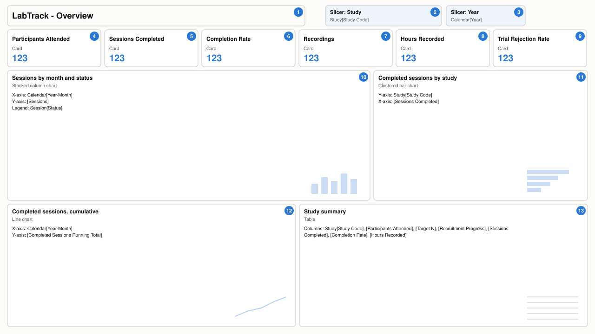
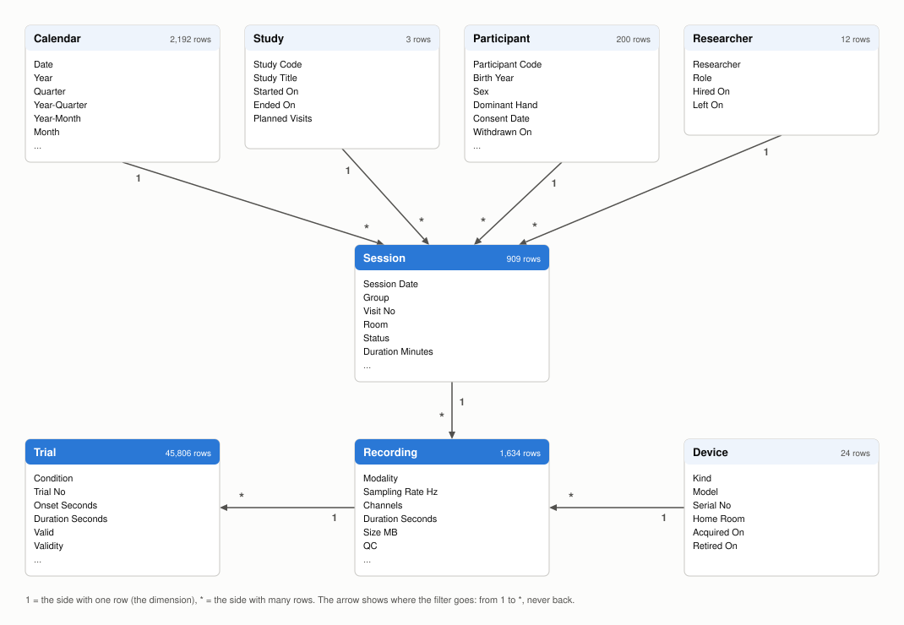

# labtrack-bi

[](https://github.com/juanbezerra1/labtrack-bi/actions/workflows/ci.yml)

**A Power BI project for a biosignal lab, kept as text.**

A Power BI project (`.pbip`) is a folder of text files, not one binary `.pbix`, so Git can show what changed and
somebody can review it. This repository is one: a semantic model written in TMDL (eight tables, seven relationships,
46 DAX measures), the Power Query that loads it, a custom theme, a report with four pages, and the **numbers that Power
BI must show**, worked out twice by two independent routes. The lab is invented and so is every row: the data is the
`medium` export of [labtrack-db](https://github.com/juanbezerra1/labtrack-db), my PostgreSQL schema for the same lab.

Também em português: [README.pt-BR.md](README.pt-BR.md)

## At a glance

| What | Count |
|---|---:|
| Tables in the model (eight with data, plus `Measures`) | 9 |
| Relationships (all many-to-one, one direction) | 7 |
| DAX measures, in six display folders | 46 |
| Power Query queries (eight tables and the `DataFolder` parameter) | 9 |
| Report pages (1280 x 720) | 4 |
| Visuals in the specification of the pages | 46 |
| Check queries, each with its table of expected numbers | 13 |
| Rows of synthetic data in the eight CSV files | 50,780 |

## What is here, and what is not yet

**Here, and tested without Power BI.** The model, the measures, the queries, the theme and the empty pages are made by
one script from one specification ([`src/labtrack_bi/spec.py`](src/labtrack_bi/spec.py)), and the tests compare every
generated file with it. The expected numbers were computed by a second, hand-written implementation of the 46
measures and then compared, one by one, with SQL written from the definitions of the measures and run on the database
that the CSV files came from: no difference. The Power Query is checked with Microsoft's own parser, and the JSON files
of the report with Microsoft's published schemas. What was checked, and how, is in
[`docs/verification.md`](docs/verification.md).

**Not here yet, on purpose.** The 46 visuals. The report has its four pages and a theme, empty, and
[`docs/report-spec.md`](docs/report-spec.md) says what to build on each one: type, title, position and fields, with a
drawing of the page. You build them in Power BI Desktop by following the [build guide](docs/build-guide.md), and
`check-report` compares what Desktop saved with the specification.

**Not tested, and I say so.** I have no Power BI Desktop (it only runs on Windows), so the project has never been opened
in it, the Power Query has been parsed but never run against the files, and the DAX has never been run by a DAX engine.
The first thing the guide has you do is open the project and run the 13 check queries against the numbers of this
repository. If something fails there, it is a bug of mine and I want to know which query it was.

## Quick start

You need Windows with the regular **Power BI Desktop** (not the Report Server edition) to open the project, and Python
3.10 or newer, only for the checks. In a terminal in this folder:

```console
py -m pip install -e .
py -m labtrack_bi check           # every generated file is there and up to date
py -m labtrack_bi expected        # the numbers that Power BI must show, as Markdown
```

Then double-click `labtrack.pbip` and go on with [`docs/build-guide.md`](docs/build-guide.md): Phase A (about half an
hour) opens the project and checks the numbers; Phase B builds the pages. On Linux and macOS write `python3` where
this README writes `py`: they cannot open the project, but they can run every check.

## What the report will show

Four pages, one question each. The drawings are the wireframes of [`docs/report-spec.md`](docs/report-spec.md), made
from the specification (they are not screenshots).

| Page | The question | Visuals |
|---|---|---:|
| 1. Overview | How much was done, how did it end, how do the three studies compare? | 13 |
| 2. Recruitment | Who joined, how many came back for each visit, how close is each study to its target? | 13 |
| 3. Data quality | Where is the data weak: QC results, rejected trials, devices? | 12 |
| 4. Findings | What do the planted effects look like in a report, with a note that says it is synthetic? | 8 |



The model, as the Model view of Power BI must show it:



### Screenshots

<!-- screenshots:start -->
_No screenshots yet: the pages are built in Power BI Desktop. Once they exist,
`py -m labtrack_bi add-screenshots` puts them here._
<!-- screenshots:end -->

## The numbers

A few of the numbers of [`docs/expected-numbers.md`](docs/expected-numbers.md), which has the other twelve tables:

| Measure | Value |
|---|---:|
| Sessions completed, of 894 that are closed (909 in all) | 817 (91.4%) |
| Participants who attended, of 200 enrolled | 199 |
| Recordings, trials, valid trials | 1,634, 45,806, 42,052 |
| Hours recorded | 154.5 |
| Recordings that passed QC (the pending ones left out) | 87.7% |
| Trial rejection rate | 8.2% |
| Mean force variability (CV, %) with the feedback on, and off | 4.04 and 4.53 |

The last row is one of three effects that the data generator plants on purpose (feedback lowers the variability of the
force, fatigue lowers the median frequency and raises the RMS, a large stimulus lowers the alpha power). **They are not
science**: the page of findings exists to show how a report is made, and says so on the page.

## How it is made

```text
src/labtrack_bi/spec.py   the one description: tables, columns, relationships, 46 measures, 4 pages
        |  py -m labtrack_bi build
        v
model/                    Power Query (.pq), the DAX of the measures and the 13 check queries
labtrack.SemanticModel/   the model in TMDL
labtrack.Report/          the report in PBIR: four empty pages and the theme
docs/                     model, report specification, expected numbers, wireframes
```

`build` writes the project (`labtrack.pbip` and its two folders) only the first time. From the first save in Power BI
Desktop the files are Desktop's, and two commands compare what they **mean** with the specification:
`py -m labtrack_bi check-model` for the model and `py -m labtrack_bi check-report` for the visuals. The reasons for the
choices (one date path, one table of measures, `BLANK` as a result, a palette checked for colour-blind readers) are in
[`docs/design.md`](docs/design.md).

| Folder or file | What it holds |
|---|---|
| `data/` | the eight synthetic CSV files, their checksums and [a README](data/README.md) |
| `model/` | `powerquery/*.pq`, `measures.dax`, `check.dax` |
| `docs/` | [build guide](docs/build-guide.md), [design notes](docs/design.md), [model](docs/model.md), [report specification](docs/report-spec.md), [expected numbers](docs/expected-numbers.md), [verification](docs/verification.md) |
| `src/labtrack_bi/` | the generator, the second implementation of the measures (`engine.py`) and the checks |
| `tools/` | the check of the Power Query with Microsoft's parser (Node), and the SQL cross-check |
| `tests/` | the tests (`py -m pytest`, after `py -m pip install -e ".[dev]"`) |

## Limits

* One lab, synthetic data: no row-level security, no incremental refresh, no deployment to the Power BI service, no
  live connection to the database (the CSV files are its export).
* The checker compares types, titles, positions (within 8 pixels) and fields. Whether a page looks good is for your
  eyes.
* Two stacked charts (sessions by status, recordings by QC result) cannot be read without colour: they have a legend and
  tooltips but no data labels, because small segments do not fit one ([`docs/design.md`](docs/design.md#colours)).
* Not a clinical tool, and nothing here is evidence of anything about real participants.

## License

MIT, see [LICENSE](LICENSE); the third-party material is listed in [NOTICE](NOTICE).
