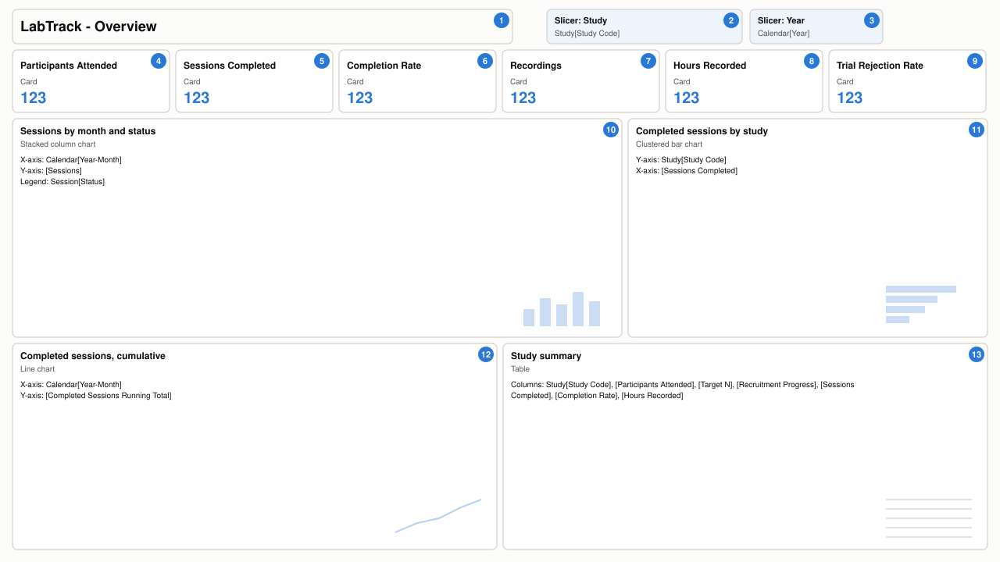
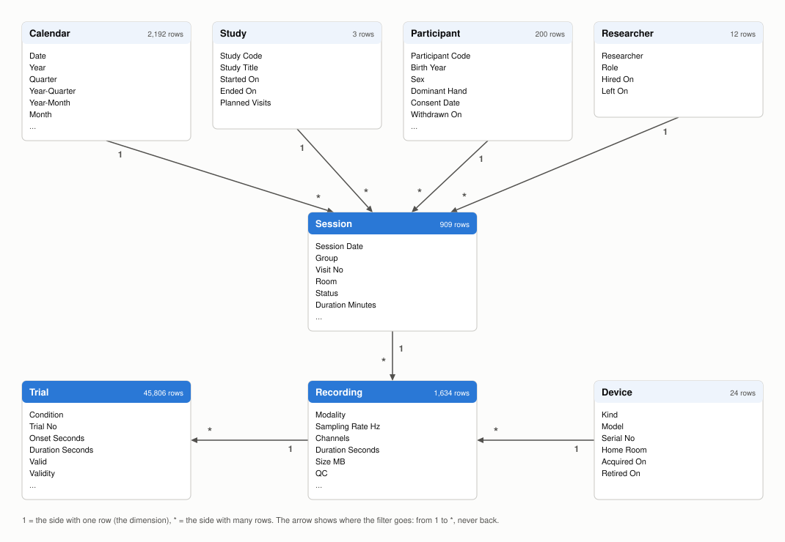

# labtrack-bi

[](https://github.com/juanbezerra1/labtrack-bi/actions/workflows/ci.yml)

**Um projeto de Power BI para um laboratório de biossinais, mantido como texto.**

Um projeto do Power BI (`.pbip`) é uma pasta de arquivos de texto, e não um único `.pbix` binário; por isso o Git mostra
o que mudou e alguém consegue revisar. Este repositório é um desses: um modelo semântico escrito em TMDL (oito tabelas,
sete relacionamentos, 46 medidas DAX), o Power Query que o carrega, um tema próprio, um relatório de quatro páginas e os
**números que o Power BI deve mostrar**, calculados duas vezes por dois caminhos independentes. O laboratório é inventado
e cada linha também: os dados são a exportação `medium` do [labtrack-db](https://github.com/juanbezerra1/labtrack-db), meu
esquema PostgreSQL para o mesmo laboratório.

Also in English: [README.md](README.md)

## Em resumo

| O quê | Quantidade |
|---|---:|
| Tabelas do modelo (oito com dados, mais `Measures`) | 9 |
| Relacionamentos (todos de muitos para um, em uma direção) | 7 |
| Medidas DAX, em seis pastas de exibição | 46 |
| Consultas do Power Query (oito tabelas e o parâmetro `DataFolder`) | 9 |
| Páginas do relatório (1280 x 720) | 4 |
| Visuais na especificação das páginas | 46 |
| Consultas de conferência, cada uma com sua tabela de números esperados | 13 |
| Linhas de dados sintéticos nos oito arquivos CSV | 50.780 |

## O que já existe, e o que ainda não

**Existe, e foi testado sem o Power BI.** O modelo, as medidas, as consultas, o tema e as páginas vazias saem de um só
script, a partir de uma só especificação ([`src/labtrack_bi/spec.py`](src/labtrack_bi/spec.py)), e os testes comparam
cada arquivo gerado com ela. Os números esperados foram calculados por uma segunda implementação, escrita à mão, das 46
medidas e depois comparados, um a um, com SQL escrito a partir das definições das medidas e executado no banco de onde os
arquivos CSV vieram: nenhuma diferença. O Power Query é conferido com o parser da própria Microsoft, e os arquivos JSON
do relatório, com os esquemas que a Microsoft publica. O que foi conferido, e como, está em
[`docs/verification.md`](docs/verification.md) (em inglês).

**Ainda não existe, de propósito.** Os 46 visuais. O relatório tem as quatro páginas e um tema, vazias, e
[`docs/report-spec.md`](docs/report-spec.md) (em inglês) diz o que montar em cada uma: tipo, título, posição e campos,
com um desenho da página. Você monta os visuais no Power BI Desktop seguindo o [guia de montagem](docs/build-guide.pt-BR.md),
e `check-report` compara o que o Desktop salvou com a especificação.

**Não testado, e eu digo.** Não tenho o Power BI Desktop (ele só roda no Windows); então o projeto nunca foi aberto nele,
o Power Query foi analisado mas nunca executado contra os arquivos, e o DAX nunca foi executado por um motor de DAX. A
primeira coisa que o guia pede é abrir o projeto e rodar as 13 consultas de conferência contra os números deste
repositório. Se algo falhar ali, é defeito meu e eu quero saber qual consulta foi.

## Início rápido

Para abrir o projeto você precisa de Windows com o **Power BI Desktop** comum (não a edição do Servidor de Relatórios) e,
só para as conferências, de Python 3.10 ou mais novo. Em um terminal, nesta pasta:

```console
py -m pip install -e .
py -m labtrack_bi check           # todo arquivo gerado existe e está atualizado
py -m labtrack_bi expected        # os números que o Power BI deve mostrar, em Markdown
```

Depois dê um duplo clique em `labtrack.pbip` e siga com [`docs/build-guide.pt-BR.md`](docs/build-guide.pt-BR.md): a Fase
A (cerca de meia hora) abre o projeto e confere os números; a Fase B monta as páginas. No Linux e no macOS escreva
`python3` onde este README escreve `py`: eles não abrem o projeto, mas rodam todas as conferências.

## O que o relatório vai mostrar

Quatro páginas, uma pergunta cada. Os desenhos são os wireframes de [`docs/report-spec.md`](docs/report-spec.md), feitos
a partir da especificação (não são capturas de tela).

| Página | A pergunta | Visuais |
|---|---|---:|
| 1. Overview | Quanto foi feito, como terminou, como os três estudos se comparam? | 13 |
| 2. Recruitment | Quem entrou, quantos voltaram a cada visita, quão perto da meta está cada estudo? | 13 |
| 3. Data quality | Onde os dados são fracos: resultados do controle de qualidade, tentativas rejeitadas, aparelhos? | 12 |
| 4. Findings | Como ficam, em um relatório, os efeitos plantados, com uma nota dizendo que são sintéticos? | 8 |



O modelo, como a Model view do Power BI deve mostrá-lo:



### Capturas de tela

<!-- screenshots:start -->
_Ainda sem capturas de tela: as páginas são montadas no Power BI Desktop. Quando existirem,
`py -m labtrack_bi add-screenshots` as coloca aqui._
<!-- screenshots:end -->

## Os números

Alguns dos números de [`docs/expected-numbers.md`](docs/expected-numbers.md) (em inglês), que traz as outras doze
tabelas:

| Medida | Valor |
|---|---:|
| Sessões concluídas, das 894 encerradas (909 no total) | 817 (91,4%) |
| Participantes que compareceram, dos 200 inscritos | 199 |
| Gravações, tentativas (trials) e tentativas válidas | 1.634, 45.806 e 42.052 |
| Horas gravadas | 154,5 |
| Gravações que passaram no controle de qualidade (as pendentes ficam de fora) | 87,7% |
| Taxa de rejeição de tentativas | 8,2% |
| Variabilidade média da força (CV, %) com o feedback ligado e desligado | 4,04 e 4,53 |

A última linha é um dos três efeitos que o gerador de dados planta de propósito (o feedback reduz a variabilidade da
força, a fadiga reduz a frequência mediana e aumenta o RMS, um estímulo grande reduz a potência alfa). **Não é
ciência**: a página de achados existe para mostrar como se faz um relatório, e diz isso na própria página.

## Como é feito

```text
src/labtrack_bi/spec.py   a descrição única: tabelas, colunas, relacionamentos, 46 medidas, 4 páginas
        |  py -m labtrack_bi build
        v
model/                    Power Query (.pq), o DAX das medidas e as 13 consultas de conferência
labtrack.SemanticModel/   o modelo em TMDL
labtrack.Report/          o relatório em PBIR: quatro páginas vazias e o tema
docs/                     modelo, especificação do relatório, números esperados, wireframes
```

O `build` escreve o projeto (`labtrack.pbip` e as duas pastas dele) só na primeira vez. A partir do primeiro salvamento
no Power BI Desktop os arquivos são do Desktop, e dois comandos comparam o que eles **significam** com a especificação:
`py -m labtrack_bi check-model` para o modelo e `py -m labtrack_bi check-report` para os visuais. Os motivos das escolhas
(um só caminho de datas, uma só tabela de medidas, `BLANK` como resultado, uma paleta conferida para quem não enxerga
todas as cores) estão em [`docs/design.md`](docs/design.md) (em inglês).

| Pasta ou arquivo | O que tem |
|---|---|
| `data/` | os oito arquivos CSV sintéticos, as somas de verificação deles e [um README](data/README.md) |
| `model/` | `powerquery/*.pq`, `measures.dax`, `check.dax` |
| `docs/` | [guia de montagem](docs/build-guide.pt-BR.md), [notas de projeto](docs/design.md), [modelo](docs/model.md), [especificação do relatório](docs/report-spec.md), [números esperados](docs/expected-numbers.md), [verificação](docs/verification.md) (todos em inglês, menos o guia) |
| `src/labtrack_bi/` | o gerador, a segunda implementação das medidas (`engine.py`) e as conferências |
| `tools/` | a conferência do Power Query com o parser da Microsoft (Node) e a conferência cruzada em SQL |
| `tests/` | os testes (`py -m pytest`, depois de `py -m pip install -e ".[dev]"`) |

## Limites

* Um laboratório, dados sintéticos: sem segurança em nível de linha, sem atualização incremental, sem publicação no
  serviço do Power BI, sem conexão ao vivo com o banco (os arquivos CSV são a exportação dele).
* A conferência compara tipos, títulos, posições (com tolerância de 8 pixels) e campos. Se a página está bonita, quem
  julga são seus olhos.
* Dois gráficos empilhados (sessões por situação, gravações por resultado do controle de qualidade) não podem ser lidos
  sem cor: têm legenda e dicas de ferramenta, mas não têm rótulos de dados, porque segmentos pequenos não comportam um
  ([`docs/design.md`](docs/design.md#colours)).
* Não é uma ferramenta clínica, e nada aqui é evidência de coisa alguma sobre participantes reais.

## Licença

MIT, veja [LICENSE](LICENSE); o material de terceiros está listado em [NOTICE](NOTICE).
