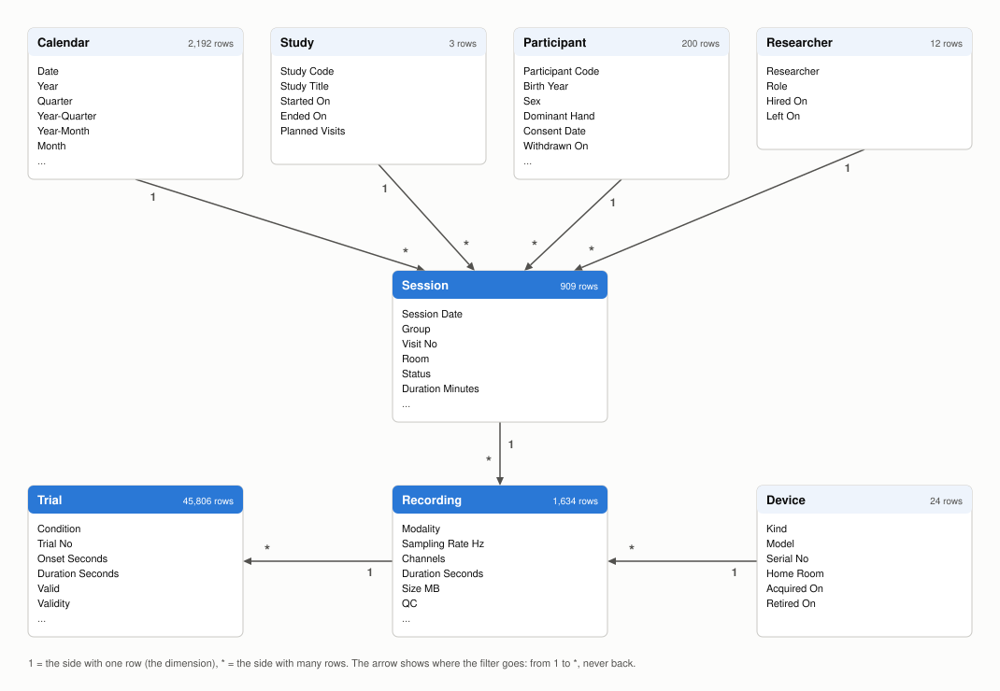

# The model

Made by `labtrack-bi build` from `src/labtrack_bi/spec.py`; do not edit by hand. The model is a star schema: four dimensions filter `Session`, `Session` and `Device` filter `Recording`, and `Recording` filters `Trial`. Filters flow one way only, from the dimension to the fact.



## Relationships

| From (many) | To (one) |
|---|---|
| `Session.Session Date` | `Calendar.Date` |
| `Session.Study Key` | `Study.Study Key` |
| `Session.Participant Key` | `Participant.Participant Key` |
| `Session.Researcher Key` | `Researcher.Researcher Key` |
| `Recording.Session Key` | `Session.Session Key` |
| `Recording.Device Key` | `Device.Device Key` |
| `Trial.Recording Key` | `Recording.Recording Key` |

All seven are many-to-one, single direction, active. Only the date of the session is related to `Calendar`: the recordings and the trials reach the calendar through their session, so there is one path and no ambiguity.

## Tables and columns

### Calendar

One row per calendar day from 2023 to 2028, so that time intelligence has no gaps. Marked as the date table.

Source: `data/dim_date.csv`.

| Column | Type | Comes from | Notes |
|---|---|---|---|
| Date | Date | `date_key` | The day. The key of the table. Key of the date table. |
| Year | Whole number | `year` |  |
| Quarter | Whole number | `quarter` |  |
| Year-Quarter | Text | made in Power Query | For example 2025 Q3. |
| Month No | Whole number | `month_no` | Orders the month names. Hidden. |
| Year-Month | Text | `year_month` | For example 2025-03. Sorts correctly as text. |
| Month | Text | `month_name` | Sorted by Month No. |
| Month Start | Date | `month_start` |  |
| ISO Weekday | Whole number | `iso_weekday` | 1 = Monday ... 7 = Sunday. Hidden. |
| Weekday | Text | `weekday_name` | Sorted by ISO Weekday. |
| Is Weekend | True/False | `is_weekend` |  |

### Study

The studies of the lab (bi.dim_study).

Source: `data/dim_study.csv`.

| Column | Type | Comes from | Notes |
|---|---|---|---|
| Study Key | Whole number | `study_key` | Hidden. |
| Study Code | Text | `study_code` | Short stable code such as FFB-01. |
| Study Title | Text | `title` |  |
| Started On | Date | `started_on` |  |
| Ended On | Date | `ended_on` | Empty while the study is open. |
| Planned Visits | Whole number | `planned_visits` |  |
| Target N | Whole number | `target_n` | How many participants the study aims to enroll. Hidden: use the measure [Target N]. Hidden. |

### Participant

Pseudonymised participants (bi.dim_participant), plus age columns made here.

Source: `data/dim_participant.csv`.

| Column | Type | Comes from | Notes |
|---|---|---|---|
| Participant Key | Whole number | `participant_key` | Hidden. |
| Participant Code | Text | `participant_code` |  |
| Birth Year | Whole number | `birth_year` |  |
| Sex | Text | `sex` |  |
| Dominant Hand | Text | `dominant_hand` (code turned into a label) |  |
| Consent Date | Date | `consent_signed_on` |  |
| Withdrawn On | Date | `withdrawn_on` |  |
| Is Withdrawn | True/False | `is_withdrawn` |  |
| Status | Text | made in Power Query |  |
| Age at Consent | Whole number | made in Power Query | Year of the consent minus birth year. |
| Age Band | Text | made in Power Query | Sorted by Age Band Order. |
| Age Band Order | Whole number | made in Power Query | Hidden. |

### Researcher

The people who run sessions (bi.dim_researcher).

Source: `data/dim_researcher.csv`.

| Column | Type | Comes from | Notes |
|---|---|---|---|
| Researcher Key | Whole number | `researcher_key` | Hidden. |
| Researcher | Text | `full_name` |  |
| Role | Text | `role` (mapped to a label) |  |
| Hired On | Date | `hired_on` |  |
| Left On | Date | `left_on` |  |

### Device

Amplifiers, dynamometers and stimulators (bi.dim_device).

Source: `data/dim_device.csv`.

| Column | Type | Comes from | Notes |
|---|---|---|---|
| Device Key | Whole number | `device_key` | Hidden. |
| Kind | Text | `kind` (mapped to a label) |  |
| Model | Text | `model` |  |
| Serial No | Text | `serial_no` |  |
| Home Room | Text | `home_room` |  |
| Acquired On | Date | `acquired_on` |  |
| Retired On | Date | `retired_on` |  |

### Session

One row per session (bi.fact_session). Its recordings are counted from the Recording table, so the two pre-computed columns n_recordings and hours_recorded are not imported.

Source: `data/fact_session.csv`.

| Column | Type | Comes from | Notes |
|---|---|---|---|
| Session Key | Whole number | `session_key` | Hidden. |
| Session Date | Date | `date_key` | The lab's calendar day of the session. |
| Study Key | Whole number | `study_key` | Hidden. |
| Participant Key | Whole number | `participant_key` | Hidden. |
| Researcher Key | Whole number | `researcher_key` | Hidden. |
| Group | Text | `group_label` (code turned into a label) | Control or intervention. |
| Visit No | Whole number | `visit_no` |  |
| Room | Text | `room` |  |
| Status | Text | `status` (code turned into a label) | Completed, Cancelled, No Show or Scheduled (a session in the future). |
| Duration Minutes | Whole number | `duration_min` |  |
| Starts At | Date and time | `starts_local` |  |

Not imported: `n_recordings`, `hours_recorded`.

### Recording

One row per recording (bi.fact_recording). The date comes through Session; the trial counts are counted from the Trial table, so date_key, n_trials and n_valid_trials are not imported.

Source: `data/fact_recording.csv`.

| Column | Type | Comes from | Notes |
|---|---|---|---|
| Recording Key | Whole number | `recording_key` | Hidden. |
| Session Key | Whole number | `session_key` | Hidden. |
| Device Key | Whole number | `device_key` | Hidden. |
| Modality | Text | `modality` (mapped to a label) |  |
| Sampling Rate Hz | Whole number | `sampling_rate_hz` |  |
| Channels | Whole number | `n_channels` |  |
| Duration Seconds | Decimal number | `duration_s` |  |
| Size MB | Decimal number | `size_mb` |  |
| QC | Text | `qc` (code turned into a label) | Quality-control result: Passed, Flagged, Rejected or Pending. |
| Device Calibrated | True/False | `device_calibrated` | False when the device had no valid passed calibration on the day of the recording. |
| Calibration | Text | made in Power Query |  |

Not imported: `date_key`, `n_trials`, `n_valid_trials`.

### Trial

One row per trial (bi.fact_trial). The session, the date and the modality come through Recording, so session_key, date_key and modality are not imported. The factors of the condition are split into columns here.

Source: `data/fact_trial.csv`.

| Column | Type | Comes from | Notes |
|---|---|---|---|
| Trial Key | Whole number | `trial_key` | Hidden. |
| Recording Key | Whole number | `recording_key` | Hidden. |
| Condition | Text | `condition` | For example hold_40_fb: hold at 40 percent of maximum force, feedback on. |
| Trial No | Whole number | `trial_no` |  |
| Onset Seconds | Decimal number | `onset_s` |  |
| Duration Seconds | Decimal number | `duration_s` |  |
| Valid | True/False | `valid` | False when the trial was rejected in review. |
| Validity | Text | made in Power Query |  |
| Reject Reason | Text | `reject_reason` (code turned into a label) |  |
| Feedback | Text | made in Power Query | On or Off for the force-feedback trials; empty for the others. |
| Hold Level | Whole number | made in Power Query | Percent of maximum force of a hold trial; empty for the others. |
| Fatigue Phase | Text | made in Power Query | Pre or Post the fatiguing task; empty outside EMG-03. |
| Stimulus Size | Text | made in Power Query | Small or Large visual stimulus; empty outside EEG-02. |
| RMS | Decimal number | `rms_mean_uv` | EMG: root mean square amplitude in microvolts, mean of the channels. |
| MNF | Decimal number | `mnf_hz` | EMG: mean frequency of the spectrum in hertz, mean of the channels. |
| MDF | Decimal number | `mdf_hz` | EMG: median frequency of the spectrum in hertz, mean of the channels. |
| Alpha Power | Decimal number | `alpha_power_uv2` | EEG: band power at 8 to 13 Hz in microvolts squared, mean of the channels. |
| Peak Force | Decimal number | `peak_force_n` | Force: the highest force of the trial in newtons. |
| Force CV | Decimal number | `force_cv_pct` | Force: coefficient of variation of the force in the hold phase, in percent. Lower is steadier. |

Not imported: `session_key`, `date_key`, `modality`.

## Measures (table `Measures`)

46 explicit measures. The model discourages implicit measures, so every number in the report is one of these.

| Folder | Measure | Format | What it is |
|---|---|---|---|
| 1 Counts | Sessions | `#,0` | Sessions in the current filter, whatever their status. |
| 1 Counts | Participants Enrolled | `#,0` | Participants with at least one session booked in the current filter. |
| 1 Counts | Participants Attended | `#,0` | Participants with at least one completed session. Not additive across studies: one person can be in two. |
| 1 Counts | Recordings | `#,0` | Recordings in the current filter. |
| 1 Counts | Trials | `#,0` | Trials in the current filter, valid or rejected. |
| 1 Counts | Hours Recorded | `#,0.0` | Total recording time in hours. |
| 1 Counts | Data Volume GB | `#,0.00` | Total size of the recording files in gigabytes. |
| 1 Counts | Devices Used | `#,0` | Devices that made at least one recording. |
| 2 Sessions | Sessions Completed | `#,0` | Sessions that took place. |
| 2 Sessions | Sessions Cancelled | `#,0` | Sessions cancelled. |
| 2 Sessions | Sessions No Show | `#,0` | Sessions where the participant did not come. |
| 2 Sessions | Sessions Scheduled | `#,0` | Sessions still in the future. |
| 2 Sessions | Sessions Closed | `#,0` | Sessions whose day has passed: completed, cancelled or no show. |
| 2 Sessions | Completion Rate | `0.0%` | Completed sessions over closed sessions. |
| 2 Sessions | No Show Rate | `0.0%` | No-show sessions over closed sessions. |
| 2 Sessions | Cancellation Rate | `0.0%` | Cancelled sessions over closed sessions. |
| 2 Sessions | Avg Session Minutes | `0.0` | Mean length of a completed session, in minutes. |
| 3 Time | Last Completed Session Date | `Short Date` | The day of the latest completed session in the current filter. |
| 3 Time | Sessions YTD | `#,0` | Sessions from 1 January to the end of the period. |
| 3 Time | Sessions Previous Year | `#,0` | Sessions in the same period one year earlier. |
| 3 Time | Sessions YoY | `0.0%` | Change of the number of sessions against the same period one year earlier. |
| 3 Time | Completed Sessions Running Total | `#,0` | Completed sessions from the start up to the end of the period; blank after the last completed session. |
| 3 Time | Participants Attended Running Total | `#,0` | Participants who had attended by the end of the period; blank after the last completed session. |
| 4 Recruitment | Target N | `#,0` | The number of participants the studies aim to enroll. |
| 4 Recruitment | Recruitment Progress | `0.0%` | Participants who attended over the target. |
| 4 Recruitment | Participants Withdrawn | `#,0` | Participants with a session in the filter who later withdrew consent. |
| 4 Recruitment | Withdrawal Rate | `0.0%` | Withdrawn over enrolled. |
| 4 Recruitment | Visit Retention | `0.0%` | Participants who attended this visit over those who attended visit 1. Blank unless one visit is selected: put Visit No on the axis. |
| 5 Quality | Recordings Passed QC | `#,0` | Recordings that passed quality control. |
| 5 Quality | QC Pass Rate | `0.0%` | Passed over recordings already reviewed (pending ones are left out). |
| 5 Quality | Uncalibrated Recordings | `#,0` | Recordings made with a device that had no valid passed calibration that day. |
| 5 Quality | Uncalibrated Rate | `0.0%` | Uncalibrated recordings over recordings. |
| 5 Quality | Valid Trials | `#,0` | Trials that were not rejected. |
| 5 Quality | Rejected Trials | `#,0` | Trials rejected in review. |
| 5 Quality | Trial Rejection Rate | `0.0%` | Rejected trials over trials. |
| 5 Quality | Avg Trials per Recording | `0.0` | Trials divided by recordings. |
| 6 Findings | Mean Force CV | `0.000` | Mean coefficient of variation of the force over valid force trials, in percent. |
| 6 Findings | Mean Force CV Feedback On | `0.000` | Mean force CV in trials with the feedback on. |
| 6 Findings | Mean Force CV Feedback Off | `0.000` | Mean force CV in trials with the feedback off. |
| 6 Findings | Feedback Effect on Force CV | `0.000` | Feedback on minus feedback off; negative means steadier force with the feedback. |
| 6 Findings | Mean MDF | `0.00` | Mean median frequency of the EMG over valid trials, in hertz. |
| 6 Findings | Mean RMS | `0.00` | Mean RMS amplitude of the EMG over valid trials, in microvolts. |
| 6 Findings | Mean Alpha Power | `0.00` | Mean alpha band power of the EEG over valid trials, in microvolts squared. |
| 6 Findings | MDF Change After Fatigue | `0.00` | Median frequency after the fatiguing task minus before it, in hertz. |
| 6 Findings | RMS Change After Fatigue | `0.00` | RMS amplitude after the fatiguing task minus before it, in microvolts. |
| 6 Findings | Alpha Change Large vs Small Stimulus | `0.00` | Alpha power with the large stimulus minus the small one, in microvolts squared. |

### The DAX of every measure

**Sessions**

```dax
COUNTROWS(Session)
```

**Participants Enrolled**

```dax
DISTINCTCOUNT(Session[Participant Key])
```

**Participants Attended**

```dax
CALCULATE(DISTINCTCOUNT(Session[Participant Key]), Session[Status] = "Completed")
```

**Recordings**

```dax
COUNTROWS(Recording)
```

**Trials**

```dax
COUNTROWS(Trial)
```

**Hours Recorded**

```dax
DIVIDE(SUM(Recording[Duration Seconds]), 3600)
```

**Data Volume GB**

```dax
DIVIDE(SUM(Recording[Size MB]), 1024)
```

**Devices Used**

```dax
DISTINCTCOUNT(Recording[Device Key])
```

**Sessions Completed**

```dax
CALCULATE([Sessions], Session[Status] = "Completed")
```

**Sessions Cancelled**

```dax
CALCULATE([Sessions], Session[Status] = "Cancelled")
```

**Sessions No Show**

```dax
CALCULATE([Sessions], Session[Status] = "No Show")
```

**Sessions Scheduled**

```dax
CALCULATE([Sessions], Session[Status] = "Scheduled")
```

**Sessions Closed**

```dax
[Sessions] - [Sessions Scheduled]
```

**Completion Rate**

```dax
DIVIDE([Sessions Completed], [Sessions Closed])
```

**No Show Rate**

```dax
DIVIDE([Sessions No Show], [Sessions Closed])
```

**Cancellation Rate**

```dax
DIVIDE([Sessions Cancelled], [Sessions Closed])
```

**Avg Session Minutes**

```dax
CALCULATE(AVERAGE(Session[Duration Minutes]), Session[Status] = "Completed")
```

**Last Completed Session Date**

```dax
CALCULATE(MAX(Session[Session Date]), Session[Status] = "Completed")
```

**Sessions YTD**

```dax
TOTALYTD([Sessions], 'Calendar'[Date])
```

**Sessions Previous Year**

```dax
CALCULATE([Sessions], SAMEPERIODLASTYEAR('Calendar'[Date]))
```

**Sessions YoY**

```dax
DIVIDE([Sessions] - [Sessions Previous Year], [Sessions Previous Year])
```

**Completed Sessions Running Total**

```dax
VAR LastDay = CALCULATE([Last Completed Session Date], REMOVEFILTERS('Calendar'))
VAR ThisDay = MAX('Calendar'[Date])
RETURN
    IF(
        MIN('Calendar'[Date]) <= LastDay,
        CALCULATE([Sessions Completed], FILTER(ALL('Calendar'), 'Calendar'[Date] <= ThisDay))
    )
```

**Participants Attended Running Total**

```dax
VAR LastDay = CALCULATE([Last Completed Session Date], REMOVEFILTERS('Calendar'))
VAR ThisDay = MAX('Calendar'[Date])
RETURN
    IF(
        MIN('Calendar'[Date]) <= LastDay,
        CALCULATE([Participants Attended], FILTER(ALL('Calendar'), 'Calendar'[Date] <= ThisDay))
    )
```

**Target N**

```dax
SUM(Study[Target N])
```

**Recruitment Progress**

```dax
DIVIDE([Participants Attended], [Target N])
```

**Participants Withdrawn**

```dax
CALCULATE(DISTINCTCOUNT(Session[Participant Key]), Participant[Is Withdrawn] = TRUE())
```

**Withdrawal Rate**

```dax
DIVIDE([Participants Withdrawn], [Participants Enrolled])
```

**Visit Retention**

```dax
IF(
    HASONEVALUE(Session[Visit No]),
    DIVIDE([Participants Attended], CALCULATE([Participants Attended], Session[Visit No] = 1))
)
```

**Recordings Passed QC**

```dax
CALCULATE([Recordings], Recording[QC] = "Passed")
```

**QC Pass Rate**

```dax
DIVIDE([Recordings Passed QC], [Recordings] - CALCULATE([Recordings], Recording[QC] = "Pending"))
```

**Uncalibrated Recordings**

```dax
CALCULATE([Recordings], Recording[Device Calibrated] = FALSE())
```

**Uncalibrated Rate**

```dax
DIVIDE([Uncalibrated Recordings], [Recordings])
```

**Valid Trials**

```dax
CALCULATE([Trials], Trial[Valid] = TRUE())
```

**Rejected Trials**

```dax
CALCULATE([Trials], Trial[Valid] = FALSE())
```

**Trial Rejection Rate**

```dax
DIVIDE([Rejected Trials], [Trials])
```

**Avg Trials per Recording**

```dax
DIVIDE([Trials], [Recordings])
```

**Mean Force CV**

```dax
CALCULATE(AVERAGE(Trial[Force CV]), Trial[Valid] = TRUE())
```

**Mean Force CV Feedback On**

```dax
CALCULATE([Mean Force CV], Trial[Feedback] = "On")
```

**Mean Force CV Feedback Off**

```dax
CALCULATE([Mean Force CV], Trial[Feedback] = "Off")
```

**Feedback Effect on Force CV**

```dax
[Mean Force CV Feedback On] - [Mean Force CV Feedback Off]
```

**Mean MDF**

```dax
CALCULATE(AVERAGE(Trial[MDF]), Trial[Valid] = TRUE())
```

**Mean RMS**

```dax
CALCULATE(AVERAGE(Trial[RMS]), Trial[Valid] = TRUE())
```

**Mean Alpha Power**

```dax
CALCULATE(AVERAGE(Trial[Alpha Power]), Trial[Valid] = TRUE())
```

**MDF Change After Fatigue**

```dax
CALCULATE([Mean MDF], Trial[Fatigue Phase] = "Post") - CALCULATE([Mean MDF], Trial[Fatigue Phase] = "Pre")
```

**RMS Change After Fatigue**

```dax
CALCULATE([Mean RMS], Trial[Fatigue Phase] = "Post") - CALCULATE([Mean RMS], Trial[Fatigue Phase] = "Pre")
```

**Alpha Change Large vs Small Stimulus**

```dax
CALCULATE([Mean Alpha Power], Trial[Stimulus Size] = "Large") - CALCULATE([Mean Alpha Power], Trial[Stimulus Size] = "Small")
```
