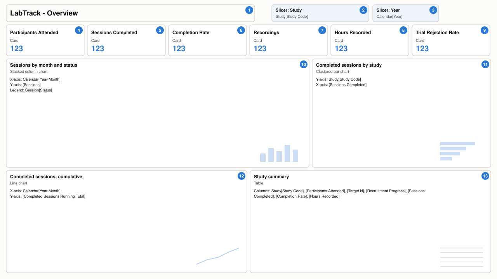
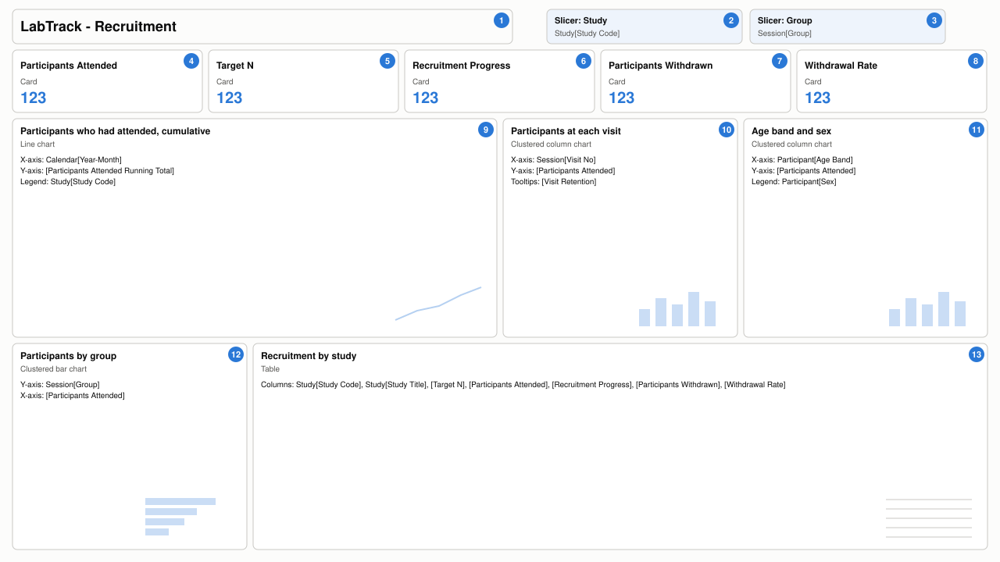
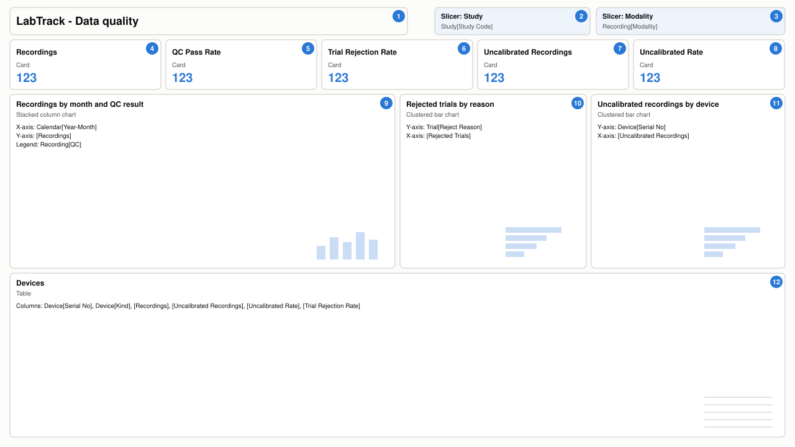
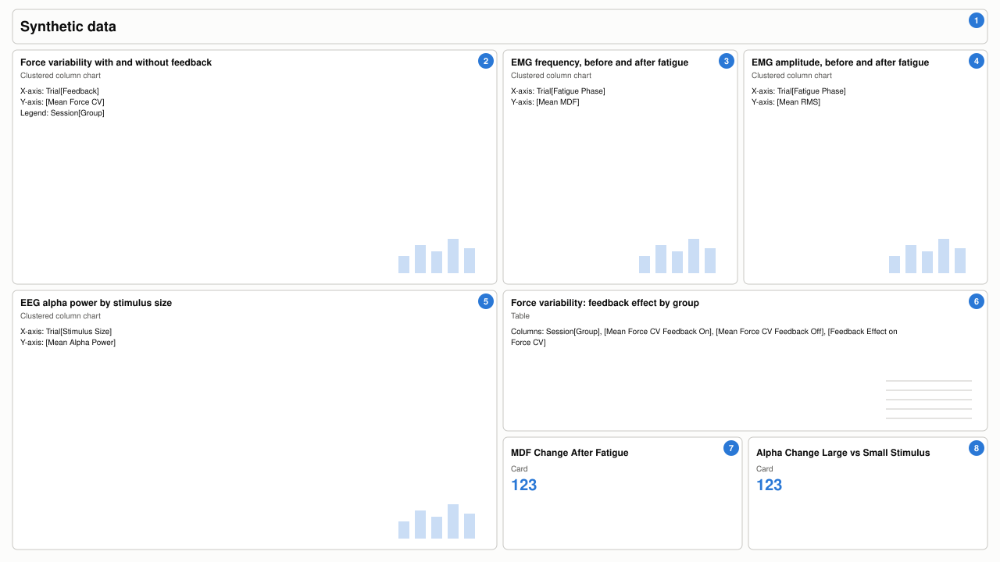

# The report: what to build

Made by `labtrack-bi build` from `src/labtrack_bi/spec.py`; do not edit by hand. `labtrack.pbip` already has the four pages (empty, 1280 x 720, with the LabTrack theme). You build the visuals, following the list of each page. The step by step is in [build-guide.md](build-guide.md).

How to read a list: **Position** is x, y, width, height in pixels on the 1280 x 720 page (Format > General > Properties > Size and Position). **Fields** are what to drag into each well; `Table[Column]` is a column, `[Name]` is a measure of the table Measures. The number of the first column is the number in the drawing.

Rules that apply to every visual: no more than four series in a chart, and a legend whenever there are two or more; data labels on bars and columns with one series; no dual axes, no pie or donut; the name of the visual (Format > General > Title) is the one in the list; alt text (Format > General > Alt text) says in one sentence what the visual shows.

## Page 1: Overview

How much work was done, how it ended, and how the three studies compare.

| # | Visual | Title | Position | Fields | Notes |
|---|---|---|---|---|---|
| 1 | Text box | LabTrack - Overview | 16, 12, 640, 44 | - | Text box, 20 pt semibold. Add the sentence 'Synthetic data' under the title in 10 pt. |
| 2 | Slicer | Study | 700, 12, 250, 44 | Field: `Study[Study Code]` | Style: Dropdown. |
| 3 | Slicer | Year | 960, 12, 170, 44 | Field: `Calendar[Year]` | Style: Dropdown; select 2024, 2025 and 2026 or leave it empty. |
| 4 | Card | Participants Attended | 16, 64, 201, 80 | Fields: `[Participants Attended]` |  |
| 5 | Card | Sessions Completed | 225, 64, 201, 80 | Fields: `[Sessions Completed]` |  |
| 6 | Card | Completion Rate | 434, 64, 201, 80 | Fields: `[Completion Rate]` |  |
| 7 | Card | Recordings | 643, 64, 201, 80 | Fields: `[Recordings]` |  |
| 8 | Card | Hours Recorded | 852, 64, 201, 80 | Fields: `[Hours Recorded]` |  |
| 9 | Card | Trial Rejection Rate | 1061, 64, 201, 80 | Fields: `[Trial Rejection Rate]` |  |
| 10 | Stacked column chart | Sessions by month and status | 16, 152, 780, 280 | X-axis: `Calendar[Year-Month]` Y-axis: `[Sessions]` Legend: `Session[Status]` | Filter the visual to Calendar[Year] 2024 to 2026. Turn the data labels off; keep the legend. |
| 11 | Clustered bar chart | Completed sessions by study | 804, 152, 460, 280 | Y-axis: `Study[Study Code]` X-axis: `[Sessions Completed]` | Data labels on. |
| 12 | Line chart | Completed sessions, cumulative | 16, 440, 620, 264 | X-axis: `Calendar[Year-Month]` Y-axis: `[Completed Sessions Running Total]` | Filter the visual to Calendar[Year] 2024 to 2026. The line stops at the last completed session on purpose. |
| 13 | Table | Study summary | 644, 440, 620, 264 | Columns: `Study[Study Code]`, `[Participants Attended]`, `[Target N]`, `[Recruitment Progress]`, `[Sessions Completed]`, `[Completion Rate]`, `[Hours Recorded]` | Turn the totals row on. Participants Attended is not additive across studies, so the total is smaller than the sum. |

## Page 2: Recruitment

Who joined, how many came back for each visit, and how close each study is to its target.

| # | Visual | Title | Position | Fields | Notes |
|---|---|---|---|---|---|
| 1 | Text box | LabTrack - Recruitment | 16, 12, 640, 44 | - | Text box, 20 pt semibold. |
| 2 | Slicer | Study | 700, 12, 250, 44 | Field: `Study[Study Code]` | Style: Dropdown. |
| 3 | Slicer | Group | 960, 12, 250, 44 | Field: `Session[Group]` | Style: Tile, horizontal (a row of buttons). |
| 4 | Card | Participants Attended | 16, 64, 243, 80 | Fields: `[Participants Attended]` |  |
| 5 | Card | Target N | 267, 64, 243, 80 | Fields: `[Target N]` |  |
| 6 | Card | Recruitment Progress | 518, 64, 243, 80 | Fields: `[Recruitment Progress]` |  |
| 7 | Card | Participants Withdrawn | 769, 64, 243, 80 | Fields: `[Participants Withdrawn]` |  |
| 8 | Card | Withdrawal Rate | 1020, 64, 243, 80 | Fields: `[Withdrawal Rate]` |  |
| 9 | Line chart | Participants who had attended, cumulative | 16, 152, 620, 280 | X-axis: `Calendar[Year-Month]` Y-axis: `[Participants Attended Running Total]` Legend: `Study[Study Code]` | Filter the visual to Calendar[Year] 2024 to 2026. Three lines, one per study; turn data labels on for the last point. |
| 10 | Clustered column chart | Participants at each visit | 644, 152, 300, 280 | X-axis: `Session[Visit No]` Y-axis: `[Participants Attended]` Tooltips: `[Visit Retention]` | Filter the visual to Visit No less than or equal to 4: every study plans four visits and the higher numbers are extra visits. Data labels on. The tooltip shows how many came back compared with visit 1. |
| 11 | Clustered column chart | Age band and sex | 952, 152, 312, 280 | X-axis: `Participant[Age Band]` Y-axis: `[Participants Attended]` Legend: `Participant[Sex]` | Data labels on (two series only). |
| 12 | Clustered bar chart | Participants by group | 16, 440, 300, 264 | Y-axis: `Session[Group]` X-axis: `[Participants Attended]` | Data labels on. |
| 13 | Table | Recruitment by study | 324, 440, 940, 264 | Columns: `Study[Study Code]`, `Study[Study Title]`, `[Target N]`, `[Participants Attended]`, `[Recruitment Progress]`, `[Participants Withdrawn]`, `[Withdrawal Rate]` | Add data bars to Recruitment Progress (Format > Cell elements). |

## Page 3: Data quality

Where the data is weak: reviews that failed, trials rejected, and recordings made with devices that were not calibrated.

| # | Visual | Title | Position | Fields | Notes |
|---|---|---|---|---|---|
| 1 | Text box | LabTrack - Data quality | 16, 12, 640, 44 | - | Text box, 20 pt semibold. |
| 2 | Slicer | Study | 700, 12, 250, 44 | Field: `Study[Study Code]` | Style: Dropdown. |
| 3 | Slicer | Modality | 960, 12, 304, 44 | Field: `Recording[Modality]` | Style: Tile, horizontal (a row of buttons). |
| 4 | Card | Recordings | 16, 64, 243, 80 | Fields: `[Recordings]` |  |
| 5 | Card | QC Pass Rate | 267, 64, 243, 80 | Fields: `[QC Pass Rate]` |  |
| 6 | Card | Trial Rejection Rate | 518, 64, 243, 80 | Fields: `[Trial Rejection Rate]` |  |
| 7 | Card | Uncalibrated Recordings | 769, 64, 243, 80 | Fields: `[Uncalibrated Recordings]` |  |
| 8 | Card | Uncalibrated Rate | 1020, 64, 243, 80 | Fields: `[Uncalibrated Rate]` |  |
| 9 | Stacked column chart | Recordings by month and QC result | 16, 152, 620, 280 | X-axis: `Calendar[Year-Month]` Y-axis: `[Recordings]` Legend: `Recording[QC]` | Filter the visual to Calendar[Year] 2024 to 2026. Four series: keep the legend visible. |
| 10 | Clustered bar chart | Rejected trials by reason | 644, 152, 300, 280 | Y-axis: `Trial[Reject Reason]` X-axis: `[Rejected Trials]` | Sort by Rejected Trials, descending. Data labels on. Filter out the blank reason. |
| 11 | Clustered bar chart | Uncalibrated recordings by device | 952, 152, 312, 280 | Y-axis: `Device[Serial No]` X-axis: `[Uncalibrated Recordings]` | Top N filter: top 8 by Uncalibrated Recordings, and keep only values above 0. Data labels on. |
| 12 | Table | Devices | 16, 440, 1248, 264 | Columns: `Device[Serial No]`, `Device[Kind]`, `[Recordings]`, `[Uncalibrated Recordings]`, `[Uncalibrated Rate]`, `[Trial Rejection Rate]` | Sort by Uncalibrated Rate, descending. Add data bars to Uncalibrated Rate. |

## Page 4: Findings

Three effects planted in the synthetic data, shown the way a real report would show them.

| # | Visual | Title | Position | Fields | Notes |
|---|---|---|---|---|---|
| 1 | Text box | Synthetic data | 16, 12, 1248, 44 | - | One line, 12 pt: 'Synthetic data with effects planted on purpose. This page shows the report, not scientific evidence.' |
| 2 | Clustered column chart | Force variability with and without feedback | 16, 64, 620, 300 | X-axis: `Trial[Feedback]` Y-axis: `[Mean Force CV]` Legend: `Session[Group]` | Filter the visual to Trial[Feedback] On and Off (not blank). Data labels on, 2 decimals. Lower is steadier. |
| 3 | Clustered column chart | EMG frequency, before and after fatigue | 644, 64, 300, 300 | X-axis: `Trial[Fatigue Phase]` Y-axis: `[Mean MDF]` | Filter the visual to Fatigue Phase Pre and Post (not blank). Data labels on. |
| 4 | Clustered column chart | EMG amplitude, before and after fatigue | 952, 64, 312, 300 | X-axis: `Trial[Fatigue Phase]` Y-axis: `[Mean RMS]` | Same filter as the visual to its left. Data labels on. |
| 5 | Clustered column chart | EEG alpha power by stimulus size | 16, 372, 620, 332 | X-axis: `Trial[Stimulus Size]` Y-axis: `[Mean Alpha Power]` | Filter the visual to Stimulus Size Small and Large (not blank). Data labels on. |
| 6 | Table | Force variability: feedback effect by group | 644, 372, 620, 180 | Columns: `Session[Group]`, `[Mean Force CV Feedback On]`, `[Mean Force CV Feedback Off]`, `[Feedback Effect on Force CV]` | Filter the visual to Study FFB-01 (filter pane, not a slicer). Two rows: control and intervention. |
| 7 | Card | MDF Change After Fatigue | 644, 560, 306, 144 | Fields: `[MDF Change After Fatigue]` |  |
| 8 | Card | Alpha Change Large vs Small Stimulus | 958, 560, 306, 144 | Fields: `[Alpha Change Large vs Small Stimulus]` |  |
